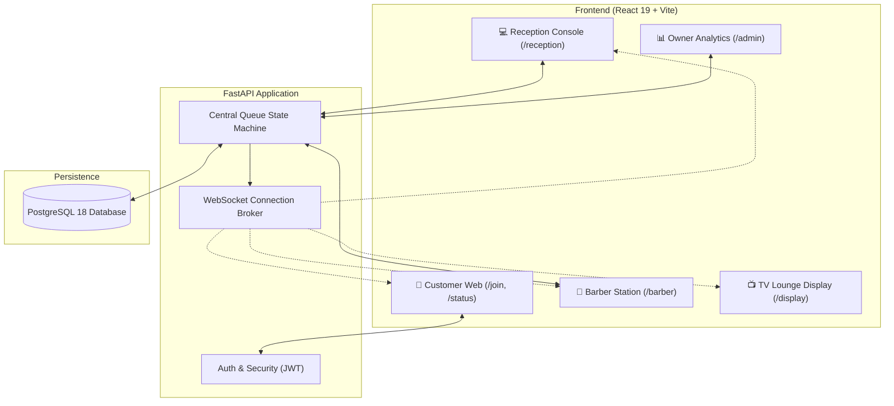

# SalonFlow — Premium Salon Queue Management System

**Live demo:** https://salonflow-demo.vercel.app  
**Hosted on:** Vercel (frontend) + Render (backend)  
**Demo Credentials:**
- **Salon Owner / Admin:** `owner@salonflow.com` / `Owner@123`
- **Receptionist Desk:** `reception@salonflow.com` / `Staff@123`
- **Barber Ravi Kumar:** `ravi@salonflow.com` / `Barber@123`
- **Barber Amit Shah:** `amit@salonflow.com` / `Barber@123`
- **Customer Mehul Desai:** `customer@salonflow.com` / `Customer@123`

---

## 1. Project Overview & Brand Identity

**SalonFlow** ("Smart Salon. Zero Waiting.") is a commercial-grade, multi-role salon queue management SaaS system designed as an MSc IT practical examination project. It connects customers, receptionists, barbers, and salon owners through a centralized Python/FastAPI backend, PostgreSQL database, React 19 frontend, and real-time WebSockets synchronization.

### Key Value Propositions
- **Eliminate Physical Waiting:** Customers join the live queue remotely from their phone, track real-time queue position and countdown timers, and receive turn alerts.
- **Unified Queue Synchronization:** Front-desk walk-in customers and mobile online entrants are merged into a single first-come, first-served queue with strict barber preference enforcement.
- **Waiting Area TV Display (`/display`):** A wall-mounted Smart TV view featuring high-contrast typography, live digital clock, current customer per barber chair, upcoming tokens, and celebratory sound chimes.
- **Bilingual Localization (English & Gujarati):** Complete localization across all customer, receptionist, barber, and admin interfaces.
- **Live Business Intelligence:** Interactive charts powered by Recharts (hourly customer traffic, weekly revenue growth, service popularity, barber throughput).

---

## 2. Technology Stack

### Frontend
- **Framework:** React 19 / Vite
- **Styling:** Tailwind CSS (Deep Navy `#253247`, Indigo `#596FE0`, Champagne Gold `#D4AF72`, Canvas `#F5F7FB`)
- **Icons:** Lucide React
- **Routing:** React Router DOM v6
- **HTTP & Sockets:** Axios with automatic JWT Bearer token injection and native WebSockets (`/ws/queue`)
- **Analytics:** Recharts (Bar, Line, and Pie charts)
- **Notifications:** Sonner + Web Audio API synthesizer for salon chimes

### Backend
- **Framework:** Python 3.12+ / FastAPI
- **ORM & Database:** SQLAlchemy 2.0 with PostgreSQL 18 (and SQLite zero-config local fallback)
- **Validation:** Pydantic v2 & `pydantic-settings`
- **Security:** Argon2 / Bcrypt password hashing + JWT Access & Refresh Token rotation
- **Testing:** Pytest (25 test cases passing across auth, queue rules, and RBAC)

---

## 3. System Architecture & Queue Rules



### Core Queue Rules
1. **Queue Lifecycle:** `WAITING` → `CALLED` → `IN_CHAIR` → `DONE`. Branching: `WAITING` → `CANCELLED`, `CALLED` → `NO_SHOW`.
2. **Barber Allocation:** Customers choosing a specific barber are strictly assigned to that barber and skipped when other barbers call next. Customers choosing "Any" go to the first available barber.
3. **Chair Invariant:** A barber can serve only one customer at a time.
4. **Anti-Duplicate Rule:** A customer cannot have multiple active tokens under the same phone number.
5. **Dynamic Waiting Time Formula:**
   $$\text{Estimated Wait} = \frac{\text{Remaining Time in Active Chairs} + \sum \text{Durations Ahead}}{\text{Available Barbers}}$$

---

## 4. Local Installation & Setup

### Prerequisites
- Node.js v18+ & npm
- Python 3.10+ & pip
- PostgreSQL 14+ (optional — automatically falls back to SQLite for local development)

### Step 1: Clone Repository
```bash
git clone https://github.com/your-username/salonflow.git
cd salonflow
```

### Step 2: Configure Environment
```bash
cp .env.example .env
```

### Step 3: Backend Setup
```bash
# Install Python dependencies
pip install -r backend/requirements.txt

# Initialize database tables and seed accounts
python -m backend.app.core.init_db

# Run FastAPI backend server
uvicorn app.main:app --app-dir backend --reload --port 8000
```
Backend Swagger Documentation will be accessible at: `http://localhost:8000/docs`

### Step 4: Frontend Setup
```bash
cd frontend
npm install
npm run dev
```
Frontend Web Application will be accessible at: `http://localhost:5173`

---

## 5. Automated Testing Suite

Run the complete 25-point automated test suite:
```bash
$env:PYTHONPATH="backend"; $env:TESTING="1"; python -m pytest backend/tests -v
```

### Verified Test Cases:
1. Customer registration with phone and password validation
2. Customer login and JWT generation
3. Password security (invalid passwords rejected with 401)
4. RBAC security (customers blocked from admin dashboard with 403)
5. RBAC security (receptionists blocked from modifying salon settings with 403)
6. Customer queue joining and token issuance (`SF-001`)
7. Duplicate active ticket prevention (returns 409 Conflict)
8. Barber preference respect (Amit calling next skips customer requesting Ravi)
9. First-Come-First-Served customer allocation
10. Single active customer per chair invariant
11. Start and Complete service state transitions
12. No-Show flow and barber release
13. Customer self-cancellation
14. Customer review submission and duplicate review prevention
15. Online queue closure cutoff enforcement
16. Gujarati and English translation file integrity
17. User password change verification
18. Database records persistence across restarts

---

## 6. Production Deployment Instructions

### Frontend (Vercel)
1. Push repository to GitHub.
2. Import project into [Vercel](https://vercel.com).
3. Set **Root Directory** to `frontend`.
4. Build Command: `npm run build` | Output Directory: `dist`.
5. Add Environment Variable: `VITE_API_URL=https://your-backend.onrender.com`.

### Backend (Render / Railway)
1. Create a **Web Service** on [Render](https://render.com).
2. Connect GitHub repository and select environment **Python 3**.
3. Build Command: `pip install -r backend/requirements.txt`
4. Start Command: `uvicorn app.main:app --app-dir backend --host 0.0.0.0 --port $PORT`
5. Create a managed **PostgreSQL Database** on Render and paste the connection string into the `DATABASE_URL` environment variable.
